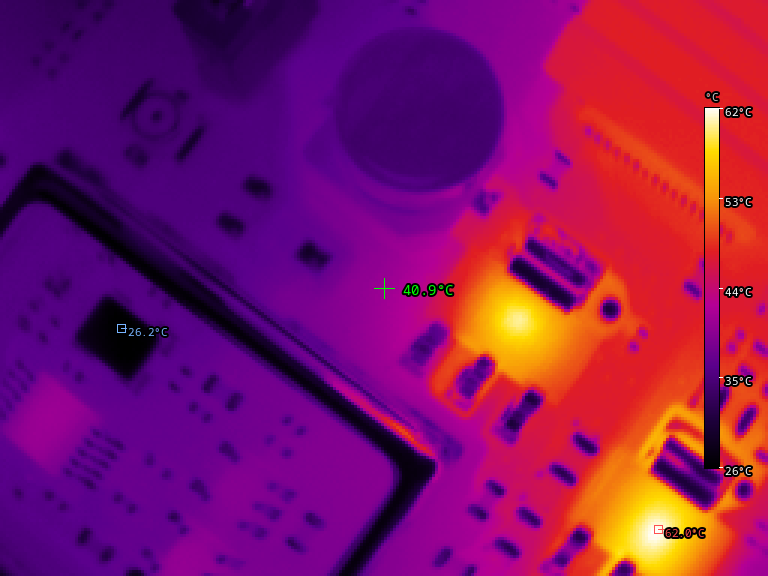

# p2-viewer

A Linux viewer for the InfiRay P2 Pro thermal camera. It decodes the camera's
radiometric data, draws temperature annotations on top, and can either show
them in a window or publish the result as a virtual camera for OBS, Zoom,
Discord or anything else that consumes a webcam.



## Requirements

- Linux (the default `v4l2` backend depends on V4L2 and `v4l2loopback`)
- Python 3.12+
- [uv](https://docs.astral.sh/uv/) for dependency management

The camera must be plugged in and visible as a V4L2 video node:

```sh
v4l2-ctl --list-devices
```

## Installation

```sh
git clone <repo-url> p2-viewer
cd p2-viewer

uv sync --extra qt              # window support (Qt/PySide6)
uv sync --extra qt --extra opencv   # plus the OpenCV capture backend
```

Extras are optional so the base install stays small:

| Extra    | Provides                          |
| -------- | --------------------------------- |
| `qt`     | Display window (PySide6)          |
| `opencv` | OpenCV capture backend            |
| `all`    | Both of the above                 |

Without `qt`, run with `--no-window`.

## Virtual camera output

To publish to a loopback device, load `v4l2loopback` with at least one device
and give it a label you will recognise:

```sh
sudo modprobe v4l2loopback video_nr=0,1,8 \
    card_label="obs-virtual-camera,thermal" devices=2
```

Then point the viewer at it (`--out /dev/video8` in the example above), and
at the camera node (`--cam /dev/video4` here; use whichever node
`v4l2-ctl --list-devices` reports):

```sh
uv run p2-viewer --cam /dev/video4 --out /dev/video8
```

Consume it with anything that reads V4L2:

```sh
ffplay -f v4l2 -input_format bgr3 -video_size 768x576 /dev/video8
```

If you use `exclusive_caps=1`, start the viewer *before* the consumer; the
device only advertises a capture format while something is writing to it.

## Usage

`--cam` is required: the viewer does not guess which node the camera is on.
Find it with `v4l2-ctl --list-devices`; it is the one whose card is a USB
Camera and which offers a 256x384 mode.

```sh
uv run p2-viewer --cam /dev/video4                               # window only
uv run p2-viewer --cam /dev/video4 --out /dev/video1             # window + virtual camera
uv run p2-viewer --cam /dev/video4 --out /dev/video1 --no-window # headless
uv run p2-viewer --cam /dev/video4 --palette rainbow
uv run p2-viewer --cam /dev/video4 --unit F
```

### Output modes

Showing a window is the default. Publishing to a virtual camera is opt-in, so
nothing is written to a device unless you name one with `--out`.

| Flags | Behaviour |
| ----- | --------- |
| `--cam` | Window only |
| `--cam --out` | Window **and** publish to `--out` |
| `--cam --out --no-window` | Publish only; safe over SSH |
| `--cam --no-window` | Error, since nothing would be produced |

If the window cannot be opened (no display, or `qt` extra not installed) it
prints a warning and carries on publishing to the virtual camera, or fails if
there is no `--out` either.

### Capture backends

| Backend  | Flag                | Notes |
| -------- | ------------------- | ----- |
| `v4l2`   | `--backend v4l2`    | **Default.** Talks to the kernel directly (ioctl + mmap). Fastest, no extra dependencies, Linux only. |
| `opencv` | `--backend opencv`  | Uses `cv2.VideoCapture`. Exists for portability — OpenCV is how the camera is reached on macOS and Windows, which have no V4L2. Slower and pulls in a large dependency, so it is not the default on Linux. |

The OpenCV backend also accepts a bare index (`--cam 4`) instead of a node
path.

The output side always uses the V4L2 writer: OpenCV's `VideoWriter` cannot
reliably target a loopback device.

### Options

| Option | Description |
| ------ | ----------- |
| `--cam PATH` | **Required.** Camera capture node, e.g. `/dev/video4` |
| `--out PATH` | Loopback device to publish to, e.g. `/dev/video1`. Omit for a window only |
| `--no-window` | Do not open a display window; needs `--out` |
| `--backend {v4l2,opencv}` | Capture backend (default `v4l2`) |
| `--palette NAME` | `ironbow` (default), `rainbow`, `whitehot`, `blackhot`, `hotmetal`, `arctic` |
| `--unit {C,F,K}` | Temperature unit for labels (default `C`) |
| `--scale N` | Integer upscale factor (default `3`, so 256x192 becomes 768x576) |
| `--font NAME` | Font family or file path (default `monospace`, resolved via `fc-match`) |
| `--font-size PX` | Label font size in pixels (default `14`); markers and legend ticks scale with it |
| `--emissivity VALUE` | Apply a grey-body emissivity correction: a number 0-1, or `auto` to use the camera's own setting |
| `--reflected-temp K` | Background temperature for that correction, in kelvin, or `auto` (default `300`) |
| `--gain {high,low}` | Set the camera's measurement range. Off by default; needs USB write access |
| `--frames N` | Stop after N frames (0 = run forever) |
| `--csv PATH` | Write every measurement to `PATH` as CSV, one row per value per frame; an existing file is overwritten |

### Logging to CSV

`--csv PATH` writes one row per measurement, so a few minutes of recording
can be loaded straight into a spreadsheet or `pandas`:

```
timestamp,name,measurement,value
2026-11-05T20:38:33.614+00:00,min,1,21.98
2026-11-05T20:38:33.614+00:00,max,1,32.54
2026-11-05T20:38:33.614+00:00,center,1,22.85
2026-11-05T20:38:33.648+00:00,min,2,21.98
```

| Column | Meaning |
| ------ | ------- |
| `timestamp` | ISO 8601 with a UTC offset and milliseconds |
| `name` | `min`, `max`, `center`, or a sample point `P1`..`P4` |
| `measurement` | Frame number, counted from 1; rows from one frame share it |
| `value` | Temperature in Celsius |

Values are always Celsius regardless of `--unit`, which only affects the
on-screen labels. They are written after any `--emissivity` correction, so
they match the numbers drawn on the image. `P1`..`Pn` rows appear only for points that are placed, and
are numbered by their position in the table, so removing a point shifts the
numbers of the ones after it. Points record the pixel under the marker, while
`min`/`max`/`center` are per-frame readings.

All progress messages go to stderr, so stdout carries only data. That check is
cheap: piping stdout to a file gives an empty file during a normal run.

### In the window

The image carries a centre crosshair, markers on the coldest and hottest
pixels, and a colour scale. On top of that the window is interactive:

| Action | Effect |
| ------ | ------ |
| Move the mouse | Temperature under the cursor, in a small readout |
| Left click | Drop a sample point, up to 4 at once |
| Right click | Remove the most recently placed point |
| `Space` or **Pause** | Freeze the image; click again to resume |
| `S` or **Snapshot** | Save the current frame as `p2pro-<timestamp>.png` in the working directory |
| `Escape` or close | Quit; `Ctrl-C` works too |

The panel in the top-left lists each sample point with its current, minimum,
maximum and average temperature since the point was placed. The `×` beside a
row removes that point, and the remaining points renumber themselves.

The `▸`/`▾` button at the end of the button row collapses the panel down to
just that row, which is useful when you want the image unobstructed. The table
only appears once at least one point is placed, so a fresh window starts
unobstructed and the toggle button is disabled until then. The glyph shows the
state: `▸` means the table is hidden, `▾` means it is showing. Without points
there is nothing to show, so the table stays hidden whether the toggle is on
or off.

The three buttons in the control strip are constant size and sit at 50%
opacity, so they stay legible over a bright thermal image without covering it.
Each glyph is centred on its own ink rather than by font metrics, which keeps
the row evenly aligned despite the glyphs coming from different fallback
fonts.

Hover, points and the panel are drawn by the window only. Frames published to
`--out` never contain them, so a virtual camera feed stays clean; use
**Snapshot** if you want the annotated image. Snapshots are the rendered frame
without any of the window overlay either.

## Camera settings

The camera accepts vendor commands over USB for palette, emissivity, object
distance, atmospheric and reflected temperature, transmittance and gain. A
small CLI is included:

```sh
uv sync --extra usb
uv run p2-viewer-vendor info          # firmware, sensor, serial number
uv run p2-viewer-vendor show          # current settings
uv run p2-viewer-vendor palette --set 11
uv run p2-viewer-vendor emissivity --set 0.95
```

This needs access to the USB device node, which normally means a udev rule:

```
# /etc/udev/rules.d/60-p2pro.rules
SUBSYSTEMS=="usb", ATTRS{idVendor}=="0bda", ATTRS{idProduct}=="5830", MODE="0666"
```

Then `sudo udevadm control --reload-rules`.

## Notes on accuracy

Temperatures are the camera's own radiometric output converted with
`kelvin = raw / 64`.

**The camera's own settings have no practical effect.** Changing the
emissivity, object distance, reflected temperature, atmospheric temperature
or transmittance does not change the values in the video stream. They are
the apparent scene temperature, as if every surface were a black body, so
any correction has to be done in software.

That is accurate for high-emissivity surfaces such as skin or matte paint,
and badly wrong for shiny metal or glass, which reflect their surroundings
instead of radiating heat.

### Measurement range

The camera has two gain settings. **High gain** (the default) is more
sensitive but saturates at about 183 C. **Low gain** reaches much further -
the same target measured around 437 C in low gain while high gain pinned it
at 183 C. Which one you want depends on what you are pointing at:

```sh
uv run p2-viewer --gain low
```

The viewer never changes this unless asked, so it does not need write access
to the USB device by default. If you need the corrected value, pass an
emissivity and the viewer will apply a grey-body correction:

```sh
uv run p2-viewer --emissivity 0.95 --reflected-temp 294
uv run p2-viewer --emissivity auto --reflected-temp auto
```

`auto` reads the values back from the camera, so if the app has written an
emissivity into it, the viewer follows along automatically. The viewer prints
the values it is using at startup.

The correction is off by default, so the viewer shows exactly what the
camera reports. Whether the vendor app applies the same correction has not
been established; comparing the two on the same target is the way to find
out.

## How the camera protocol works

The P2 Pro is a plain UVC camera, so no special driver is needed. The trick is
that one of its video modes carries extra data hidden in the image.

### Two views in one frame

The camera offers a 256x384 mode. That is twice the height of the sensor, and
the two halves are different things:

```
row   0 .. 191    the picture, in YUYV 4:2:2 colour
row 192 .. 383    the same scene, as raw temperature numbers
```

The **top half** is an ordinary image: the thermal scene rendered in whichever
false-colour palette the camera has selected. You could display it as-is, but
it only tells you how colours map to heat, not actual values.

The **bottom half** is the useful part. It is not really image data despite
sharing the YUYV container: every pixel there is a **16-bit little-endian
integer**, one per sensor pixel, at exactly the same position as the pixel in
the top half. So `bottom[0][0]` is the temperature of the same spot as
`top[0][0]`.

### Turning the numbers into degrees

The raw values are fixed point with 6 fractional bits, in kelvin:

```python
raw    = bytes[0] | (bytes[1] << 8)      # little-endian u16
kelvin = raw / 64
celsius = kelvin - 273.15
```

That is the whole decode. Values in a normal room land around 19,000–20,000,
which works out to roughly 22–25 °C.

Because every pixel has a real temperature, the viewer can take the minimum,
maximum and the pixel at the centre of the frame, and label them directly.
